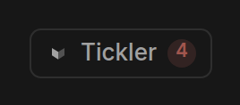
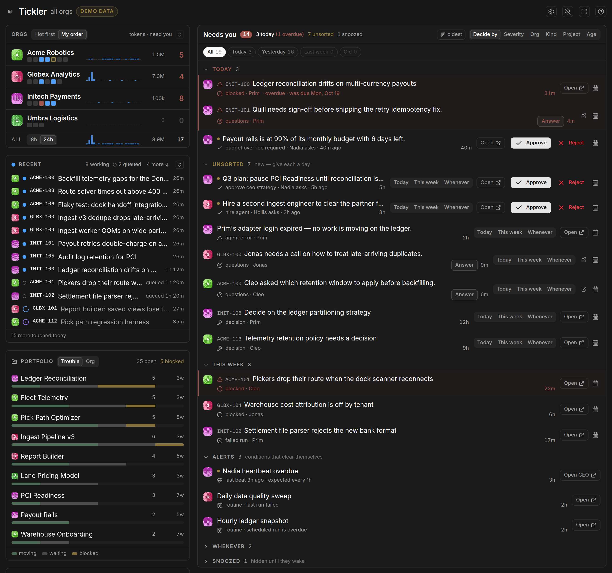

# Install

Tickler is published to npm as `paperclip-plugin-tickler`. That is the route for
running it: Paperclip fetches the package itself, and nothing needs to be built
on your side. Installing from a git clone is still supported, and is the route
for working on Tickler — see [From source](#from-source).

## From npm

### Before you start

- **An instance admin account.** Paperclip only lets instance admins install,
  upgrade or remove plugins.
- **A server that can reach the npm registry.** Paperclip installs a package by
  running `npm install` on the host it runs on, into its own plugin directory,
  so the server — not your browser — needs `npm` on its path and a way out to
  the registry.
- **A self-hosted instance.** Cloud-managed Paperclip instances refuse npm
  installs outright and only take plugins from their bundled catalog.

That is all. The package ships prebuilt and carries nothing tied to a particular
Paperclip build — in particular no copy of Paperclip's stylesheet — so upgrading
Paperclip later needs nothing from Tickler.

### 1. Install it

**From the UI (recommended).** Open **Settings → Plugins** (the **Plugin Manager**, at
`/company/settings/instance/plugins`) and click **Install Plugin**. In the
dialog, enter

```
paperclip-plugin-tickler
```

as the **npm Package Name** and click **Install**.

**From the CLI.**

```bash
paperclipai plugin install paperclip-plugin-tickler
```

A bare package name is treated as an npm package. To pin a version, pass it
with `--version`:

```bash
paperclipai plugin install paperclip-plugin-tickler --version 0.5.0
```

Before it installs, the CLI prints which instance it is about to install into:

```
Target Paperclip: http://127.0.0.1:3100
  health: status=ok  version=0.1.0  mode=local_trusted  exposure=private
Installing plugin: paperclip-plugin-tickler
✓ Installed nickallevato.plugin-tickler v0.5.0 (ready)
```

**Read that first line.** If the URL is not the instance you meant, stop and
re-point the CLI rather than trusting the result. The CLI targets whatever
`PAPERCLIP_API_URL` says, which is easy to inherit from a shell you forgot
about.

Then [confirm it loaded](#confirm-it-loaded) and
[find it in the UI](#find-it-in-the-ui).

### Upgrading an npm install

**From the page.** Tickler checks npm for a newer version of itself and offers
it: an **Update to 0.x.y** chip in the page header, and the same button on the
first row of the gear panel, which also names the version you are on. Pressing
it upgrades in place — no uninstall, settings kept — and reloads the page onto
the new build. Instance admins only, and silent when npm cannot be reached. See
[configuration.md](configuration.md#version-and-updates).

**From the CLI**, which is what that button calls and the way to pin a
particular version:

```bash
paperclipai plugin upgrade nickallevato.plugin-tickler
```

With no version, the server runs `npm install paperclip-plugin-tickler` again,
which npm resolves to the package's `latest` tag. To go to a particular version
instead:

```bash
paperclipai plugin upgrade nickallevato.plugin-tickler --payload-json '{"version":"0.5.0"}'
```

That is the same `POST /api/plugins/nickallevato.plugin-tickler/upgrade` the API
documents, with an optional `version` in the body. The upgrade is done in place:
settings are kept and the plugin's registration moves to the new version. Two
limits, both the host's:

- **The plugin must be `ready`** (or already `upgrade_pending`). Enable a
  disabled one first.
- **A version that adds a capability is refused.** Paperclip only grants
  capabilities at install, so an upgrade that declares a new one fails with an
  error naming it. Uninstall and reinstall Tickler to take that version; the
  release notes say when a version needs this. The in-page button says the same
  thing when the host refuses for this reason.

The **Reload 0.x.y** chip described under [upgrading from source](#upgrading-tickler)
does not appear for an npm install: the code Paperclip serves and the version it
has registered always move together, so there is never a newer build on disk
for the chip to offer. The **Update to 0.x.y** chip is the npm counterpart, and
appears only for an npm install — Tickler tells the two apart by the
`packagePath` on its own plugin record, which the host sets for a local-path
install and leaves null for an npm one.

### Upgrading Paperclip

Nothing to do on the Tickler side. Tickler subtracts the host's duplicate selectors
in the browser, against whichever Paperclip stylesheet the page has loaded, so a
Paperclip upgrade needs no rebuild, reinstall or restart of Tickler.

## Confirm it loaded

```bash
paperclipai plugin list
paperclipai plugin inspect nickallevato.plugin-tickler
```

You want `status=ready`. `inspect` prints the full last error if it is anything
else.

## Find it in the UI

Tickler adds two things:

**A button carrying the Tickler mark** — the folded-sheet caret — in the
breadcrumb bar, above every page in every company. A number on it counts what
you have to decide today; see [Toolbar badge](configuration.md#toolbar-badge)
to turn it off.



**A page** at `/<COMPANY-PREFIX>/tickler` — for example `/ACME/tickler`. The prefix
is the company's issue prefix. Tickler shows every company regardless of which
one's prefix is in the URL; the prefix is only there because the host mounts
plugin pages under a company route.



If the page is blank or the app looks broken, go to
[Troubleshooting](troubleshooting.md).

## From source

You clone Tickler, build it, and register the built folder with a Paperclip
instance that can read that path off disk. This is the development route: edit,
rebuild, refresh.

### Before you start

- **Node.js 24.11 or newer**, and **pnpm**.
- **A Paperclip checkout you can run from source.** Two separate reasons: local
  plugin installs read the plugin's source from disk, so the server has to be
  able to see the path you give it; and Tickler type-checks against that
  checkout's packages (see [Where the checkout has to live](#where-the-checkout-has-to-live)).
- **The instance running.** `pnpm paperclipai run` in the Paperclip checkout, or
  however you normally start yours.

### 1. Build it

```bash
git clone https://github.com/nickallevato/paperclip-tickler.git
cd paperclip-tickler
pnpm install
pnpm build
```

`pnpm build` does two things: compiles Tickler's Tailwind stylesheet and bundles
`dist/manifest.js`, `dist/worker.js` and `dist/ui/`. That `dist` folder is what
Paperclip loads. It does not read anything of Paperclip's — the host's duplicate
selectors are subtracted in the browser at runtime
([Architecture](architecture.md#why-tickler-subtracts-the-hosts-selectors)), so
there is no Paperclip UI build that has to exist first.

> **`pnpm test` needs a build first.** The test suite imports the generated
> stylesheet, which `pnpm build` produces and git ignores. On a fresh clone,
> run `pnpm build` before `pnpm test`.

### Where the checkout has to live

`package.json` declares `@paperclipai/shared` and `@paperclipai/plugin-sdk` as
`link:` dependencies pointing at `../../paperclip/packages/...`, relative to
this repository. Tickler type-checks against the real upstream types that way,
which is how it finds out about a breaking Paperclip change at build time
rather than in the browser. They are development dependencies only; the
published package does not carry them.

The consequence is a required directory layout: **the Paperclip checkout must
be two levels above this repo.**

```
~/dev/
├── paperclip/           ← the Paperclip checkout
└── plugins/
    └── paperclip-tickler/ ← this repo
```

Clone it somewhere else and `pnpm install` fails to resolve those two
dependencies. Repoint the paths in `package.json` locally if you need to — but
do not commit the repoint; it would break everyone else's layout.

### 2. Register it with your instance

```bash
paperclipai plugin install /absolute/path/to/paperclip-tickler --local
```

`--local` makes the argument a filesystem path rather than a package name; an
absolute path, or one starting `./`, `../` or `~`, is taken as one anyway. The CLI prints
its target first, as it does for [an npm install](#1-install-it) — read that
line — and then
[confirm it loaded](#confirm-it-loaded) the same way.

### Developing against it

```bash
pnpm dev   # esbuild watch + CSS rebuild
```

Paperclip watches the installed folder's `dist` output and reloads the plugin in
place, so leaving `pnpm dev` running gives you edit-and-refresh.

### Upgrading Tickler

```bash
git pull
pnpm install
pnpm build
```

The installed path has not changed, so Paperclip picks up the new `dist` on its
own — but only the code. The manifest (version, capabilities, slots) is read
once, at install, and Paperclip keeps its own copy. When a pull bumps the
version, Tickler notices on the next page load and shows a **Reload 0.x.y** chip
in its header. Clicking it asks Paperclip to re-read the plugin from disk in
place (`POST /api/plugins/nickallevato.plugin-tickler/upgrade`); settings are kept
and the page reloads onto the new build. It needs an instance admin — anyone
else gets a note saying so.

If the new version adds a capability, Paperclip will not grant it in place, so
the chip reads **Reinstall needed** instead: uninstall and reinstall Tickler from
the plugin manager.

<a id="after-a-paperclip-upgrade-rebuild-tickler"></a>

### After upgrading Paperclip itself

Nothing to do on the Tickler side — no rebuild, and no ordering to get right.
Tickler used to subtract the host's stylesheet at build time and had to be rebuilt
after every Paperclip upgrade; that now happens in the browser against whatever
stylesheet the upgraded Paperclip serves. A Paperclip upgrade can still change
the `@paperclipai/*` types a clone builds against, so run `pnpm typecheck` if
you are about to work on Tickler.

## Uninstalling

```bash
paperclipai plugin uninstall nickallevato.plugin-tickler
```

Or the **Uninstall** button on Tickler's row in the Plugin Manager. Add `--force`
to the CLI form to purge its stored config as well. Tickler's per-browser
preferences live in `localStorage` and are not touched by either; see
[Configuration](configuration.md#what-tickler-remembers).
